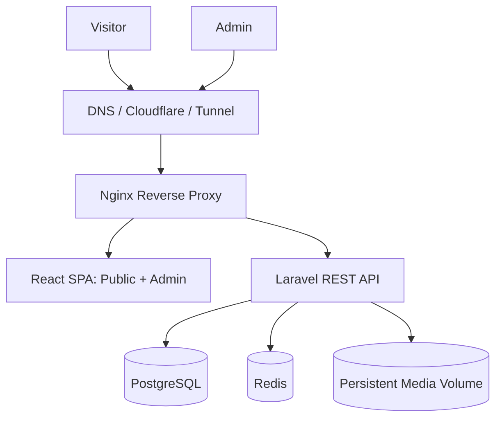

# System Architecture

## 1. Style
Decoupled frontend/backend, same-origin public entrypoint.

- React + Vite + TypeScript: public site dan admin dalam satu SPA.
- Laravel: REST API, Sanctum, validation, policies, resources, services.
- PostgreSQL: relational database.
- Redis: cache/session/queue sesuai kebutuhan.
- Nginx: reverse proxy dan static frontend.
- Docker Compose: application runtime.
- Separate Compose project: monitoring.

## 2. High-level diagram

## 3. Same-origin routing
Gunakan satu canonical origin pada MVP:
- `/` dan `/admin/*` dilayani React.
- `/api/v1/*` diteruskan Nginx ke Laravel.
- `/sanctum/*`, `/login`, `/logout` diteruskan ke Laravel sesuai route configuration.

Contoh domain hanya placeholder: `https://portfolio.example.com`. Same-origin mempermudah Sanctum cookie dan CSRF. Jika kelak API dipindah ke subdomain, evaluasi ulang stateful domains, cookie domain, CORS, CSRF, dan trusted proxies.

## 4. Request flows
### Public
Browser -> React -> `GET /api/v1/home` -> Laravel -> PostgreSQL -> API Resource JSON -> React render.

### Admin login
1. React meminta `/sanctum/csrf-cookie`.
2. Browser menerima CSRF cookie.
3. React mengirim credential ke `/login` dengan credentials dan X-XSRF-TOKEN.
4. Laravel membuat session.
5. React memanggil `/api/v1/admin/me`.
6. Request selanjutnya membawa session cookie; state-changing request membawa CSRF token.

### Content update
Form -> Form Request validation -> Policy authorization -> Service/transaction -> database -> invalidate public cache -> API response.

### Media
Admin multipart upload -> MIME/size validation -> Laravel public disk -> media metadata -> persistent volume -> URL publik yang aman.

## 5. Backend boundaries
- Controllers: HTTP orchestration.
- Form Requests: validation.
- API Resources: response serialization.
- Models: persistence and relationships.
- Policies: authorization.
- Services/Actions: multi-step business logic.
- Jobs: asynchronous work only when useful.
Hindari repository abstraction untuk semua model tanpa kebutuhan nyata.

## 6. Frontend boundaries
- Separate public/admin route groups and layouts.
- Feature folders per content module.
- Central API client, same-origin credentials.
- TypeScript contracts for API payloads.
- Admin route guards are UX only; backend authorization is the security boundary.

## 7. Publication and caching
Public endpoints must filter `published`/`active` on server side. Never rely on frontend filtering to hide drafts. Cache only public data. Invalidate relevant keys after mutations. Never publicly cache admin/auth/contact responses.

## 8. Content and media
Project case studies use ordered structured blocks in JSONB. Frontend renders allowlisted block components. Local media uses Laravel public disk backed by a persistent volume. A volume is not a backup.

## 9. Boundaries
React never connects directly to PostgreSQL/Redis. Only Nginx is public. Database and Redis remain on private Docker networks. Monitoring is separate and private/protected.
