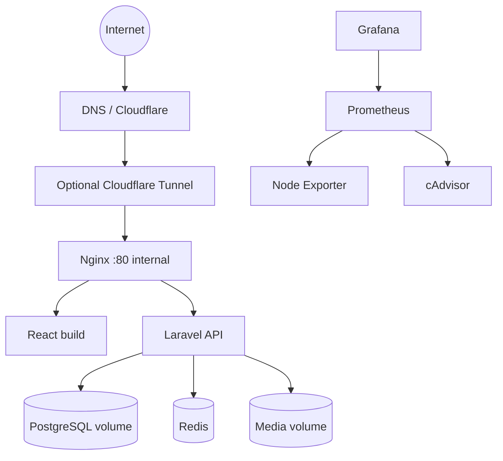

# Deployment Topology

## 1. Target
Deploy on Ubuntu server using Docker Compose. Application and monitoring have separate Compose projects. Public traffic enters through Cloudflare Tunnel or a secured reverse-proxy/TLS setup.



## 2. Compose projects
- `infra/docker/compose.yml` — Nginx, frontend, Laravel, PostgreSQL, Redis, optional queue worker.
- `infra/monitoring/compose.yml` — Prometheus, Grafana, Node Exporter, cAdvisor, optional exporters.

Project names: `portfolio-app` and `portfolio-monitoring`.

## 3. Networks
Application networks:
- `edge`: Nginx/frontend ingress.
- `app`: Nginx, Laravel, PostgreSQL, Redis as required.
- PostgreSQL/Redis must not publish host ports in production.
- Only Nginx is exposed to the tunnel or host public interface.

Monitoring:
- Separate monitoring network.
- Connect Prometheus to required targets through explicit shared external network or controlled endpoints.
- Grafana/Prometheus private or protected with authenticated access.
- Docker socket mount for cAdvisor is sensitive; understand that it grants powerful host visibility/control. Do not expose Docker API over TCP.

## 4. Persistent data
Persist PostgreSQL data, Laravel media, Grafana data, Prometheus TSDB. Redis persistence depends on whether it stores durable queue/session data. Back up PostgreSQL and media separately. Maintain off-host backup if possible.

## 5. Deployment sequence
1. Provision Ubuntu and Docker Engine/Compose plugin.
2. Clone repository.
3. Create production env files on server.
4. Build images.
5. Start PostgreSQL/Redis and wait for health checks.
6. Run migrations as controlled one-off command.
7. Bootstrap initial admin securely.
8. Start Laravel, frontend, Nginx.
9. Verify health, login, API, upload, persistence.
10. Start monitoring Compose.
11. Verify scrape targets and dashboards.
12. Configure backups and test restore.
13. Configure DNS/Tunnel or TLS; verify HTTPS.

## 6. Commands (target, after Phase 1 creates Compose files)
```bash
docker compose -f infra/docker/compose.yml -p portfolio-app config
docker compose -f infra/docker/compose.yml -p portfolio-app up -d --build
docker compose -f infra/monitoring/compose.yml -p portfolio-monitoring config
docker compose -f infra/monitoring/compose.yml -p portfolio-monitoring up -d
```

## 7. Resource sizing
Inspect server RAM/CPU/disk before enabling monitoring. Begin with conservative scrape interval and Prometheus retention. Tune based on actual resource use.
