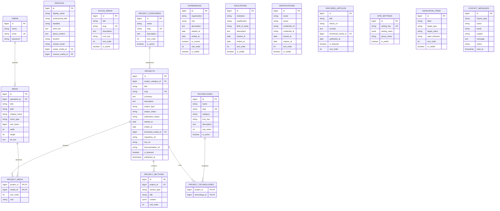

# Entity Relationship Diagram

## Relationship and constraint notes
- `profiles`: single primary profile; enforce singleton in application/bootstrap logic.
- `projects`: one primary category in MVP. Add category pivot only if multi-category is later required.
- `project_sections`: ordered JSONB blocks validated against `section_type`.
- `project_technologies`: many-to-many.
- `project_media`: gallery/architecture/screenshot attachments.
- `media.uploaded_by` references users.
- `site_settings`: JSONB values but keys and schemas are allowlisted in code. Never store secrets.
- `navigation_items.target_type` allowlist: `internal_route`, `external_url`; reject javascript/data URLs.
- Contact messages: public create only, admin read/update only.

Enum-like values:
- project_type: `personal`, `client`, `learning`, `research`
- project_status: `planned`, `in_progress`, `completed`, `archived`
- publication_status: `draft`, `published`
- section_type: `rich_text`, `image`, `image_gallery`, `architecture_diagram`, `code`, `callout`, `bullet_list`, `metrics`
- inquiry_type: `career`, `collaboration`
- message status: `unread`, `read`, `archived`

Indexes:
- Unique users.email, focus_areas.slug, project_categories.slug, projects.slug, technologies.slug, site_settings.setting_key.
- Index projects(publication_status, is_featured, published_at), projects(project_category_id), project_sections(project_id, sort_order), contact_messages(status, created_at).
- Cascade project sections and pivot rows when project deleted. Restrict media deletion while referenced.
